# 奶蛙零 · 项目报告书

> **参赛项目**：奶蛙零（Naiwa Zero）
> **赛事**：群核科技 Aholo 全球 3D AI 黑客松（Manycore Aholo Global 3D AI Hackathon）
> **提交截止**：2026-11-19 19:00
> **团队**：诸葛青云（个人参赛，团队「必胜客的汉堡最好吃」，编号 `3FO4K4VY3D07`）

---

## 一、创意起源

### 1.1 空位洞察

调研发现中文互联网的「奶蛙」迷因（2025–2026）已有大量 2D 衍生（表情包、桌宠、割草游戏），但**「抽象迷因 × 潮酷演出 × 实时可玩 3D」是空白象限**：

| 已有作品 | 形态 | 空位 |
|---|---|---|
| 《重生之奶蛙归来》 | 互动短剧（视频分支） | 非实时 3D 可玩 |
| milky-frog（微信小游戏） | 2D 割草 | 非 3D、非潮酷 |
| 奶蛙桌宠系列 | 2D 桌面宠物 | 非游戏、非 3D |

### 1.2 核心创意

**「把奶蛙的抽象无意义，装进绝区零式的高速动作演出里」**

- 玩法：16 只奶蛙家族轮换（换壳即换招）+ 三段连段 + 失衡连携（含弹反博弈，见 §3.3）
- 视觉：NPR 风格化渲染（赛璐璐 + 果冻高光）+ 复古都市箱庭
- 调性：抽象迷因 × 潮酷演出（不正经但好看）

---

## 二、技术方案

### 2.1 技术栈

| 层 | 技术 | 说明 |
|---|---|---|
| 引擎 | Three.js 0.187 | Web 实时 3D |
| 构建 | Vite 8.3.6 | 开发/生产构建 |
| 渲染 | 自研 NPR 管线 | 半兰伯特 + 色调分离 + 果冻高光 + rim light + 描边 |
| 资产 | Lux3D（官方指定） | 16 只家族角色 GLB（各自独立造型，非换色），标准版/网格/100K/PBR |
| 动画 | 程序化动画 | 6 种状态（idle/移动/攻击/受击/闪避/终结）+ 挤压拉伸 |
| 战斗 | 自研 | 3D 移动 + 连段系统 + 家族接力连携 + 弹反博弈 + 运镜演出 |

### 2.2 Lux3D 资产管线（官方指定工具）

```
参考图（AI 生成）→ Lux3D 图生 3D（标准版/网格/100K/PBR）
  → 母版 GLB（~9 万三角面）
  → gltf-transform 压缩（weld → simplify → resize1024 → webp → quantize → meshopt）
  → 运行时 GLB（18,990–19,000 三角面 / ≤385KB）
```

**资产驱动玩法**：16 只家族角色各有特性（主攻/速度/力量），伤害/速度/失衡增益不同，换人即换战术。

---

## 三、核心玩法

### 3.1 操作

| 按键 | 动作 |
|---|---|
| WASD | 3D 全向移动 |
| 空格 | 攻击：**轻点**出招（连按出三段连段：轻→重→终结）；**长按 ≥0.55 秒**蓄力，松手释放「蓄力终结」；**喧响满 [极]（3000）时松手 = 喧响终结技**（伤害 ×2 + 全程无敌 + 回满支援点，见 §3.4） |
| Shift | 闪避；攻击落地瞬间无敌帧仍生效 → **极限闪避**（慢镜 + 闪避反击资格 1.5s，见 §3.4）；对手**金光预警**窗口内按 Shift → **弹反**（消耗 1 支援点）；**红光攻击不可弹反**，HUD 提示切为「⚠ 闪避!」 |
| Tab / Q / E | 循环换壳（下一个 / 上一个 / 下一个，跳过阵亡；连携换人无冷却） |
| 1–9 / 0 | 直选第 1–9 只 / 第 10 只；**连携 QTE 期间 = 选连携成员**；鸣徽三选一期间 = 选鸣徽卡 |
| 鼠标拖动 | 旋转相机 |

### 3.2 战斗循环

```
一局 = 三连战：3 个不同招式族的对手接力（回合3=首领级，血量 <50% 狂暴：攻击 CD ×0.6 + 每 3 击一次红光不可弹反攻击）
  攻击命中 → 积累失衡黄条（克制命中积累 ×1.25、弱点属性命中 ×1.5）与喧响值
  → 黄条满 → 失衡状态 6s（对手定身、受伤 ×1.5）
  → 失衡中重击命中 → 连携 QTE：3s 子弹时间 + 数字键选队友连打（回合1/2/3 = 1/2/3 环）
     每环 +1 支援点、+300 喧响；末环=连携终结（伤害 ×1.5）
  → 弹反花 1 支援点 / 连携回 1 / 喧响终结技回满——「防御花资源、进攻回收资源」
  → 命中积累属性异常积蓄 → 强击（瞬发+硬直）/灼烧（DoT）/碎冰（冻结→爆发）/感电（受击追伤）/侵蚀（易伤）
     → 已带异常时施加异类异常 → 紊乱引爆（剩余 DoT + 紊乱段）
  → 击败本回合对手 → 鸣徽三选一（9 池抽 3，可叠层）→ 下一回合
  → 三回合打完 → 结算：时间乘数（×5 起、30s 衰 1）× 基础分（伤害/连击/弹反/连携/异常）
     + 逐回合战果 + 多维评价条（输出/连击/支援/用时）+ 鸣徽展示

招式克制（原有层，与属性轴正交共存）：6 环单环，克制 ×1.25 / 平手 ×1.0 / 被克 ×0.85
```

### 3.3 博弈深度：弹反（已实现）

> 实现位置：`src/game/counter.mjs`（弹反状态机与全部参数）；对手预警由 `src/main.mjs:588` 的 `counter.openWindow()` 开启，玩家输入在 `src/main.mjs:417` 接管（行号为 2026-11-11 审计复核值）。以下数值均为代码中实际生效值，非设计稿。

- 对手攻击前 0.25 秒「闪光预警」（`windowS: 0.25`，HUD 同步闪烁提示）
- 窗口内按 Shift → 弹反成功：对手硬直 1.2 秒 + 惩罚伤害 15 + 失衡积累 18（原「失衡增益 2 格」已随阶段 A 改为连续失衡值，见 §3.4）
- 完美弹反（更早按，窗口 0.1 秒）→ 1.5 倍伤害 + 硬直延长至 1.3 倍
- 连续弹反 → 每次 +30% 伤害加成，失败则连击数清零
- **弹反消耗 1 支援点**（阶段 B）；**红光攻击（首领狂暴期每 3 击一次）不可弹反**，只能闪避（阶段 F）——见 §3.4

---

### 3.4 绝区零对标深度改造（2026-11-12，已实现）

> 依据《绝区零》机制研究（`docs/绝区零研究/01~03`，多源交叉验证）对战斗循环做系统性对标改造：把原本孤立的机制（连段/弹反/换人/蓄力终结）咬合成「失衡 → 连携 → 支援点 → 喧响 → 异常紊乱」的**资源循环**。以下数值全部为代码实际生效值（`docs/深度改造方案-20261112.md` 为设计稿）。

| 系统 | 机制与数值 | 实现 |
|---|---|---|
| **失衡系统** | 失衡黄条 0-100 按行为积累（轻 6 / 中 9 / 三段终结 16 / 蓄力终结 22 / 弹反 18 / 闪避反击 12，×成员失衡系数、克制 ×1.25、弱点 ×1.5、鸣徽 ×1.2/层）；满 100 → **失衡 6s**：对手定身、受伤 ×1.5、阈值 ×1.25 抗性成长（封顶 ×2） | `src/game/stagger.mjs` |
| **极限闪避 + 闪避反击** | 攻击落地瞬间玩家闪避无敌帧（0.32s）仍生效 → 极限闪避：慢镜 ×0.3（0.5s）+ 闪避反击资格 1.5s；反击 = 瞬发重击（18×damageMul×冲击×克制，失衡 +12、喧响 +120） | `src/game/assist.mjs` + `src/main.mjs` |
| **支援点经济** | 3 格上限、开战满 3；**弹反成功花 1**；**连携每环 +1**；**喧响终结技回满**；无点时按 Shift 自动落为普通闪避（掐准时刻即极限闪避，ZZZ 降级路径） | `src/game/assist.mjs` |
| **连携技 QTE** | 对手失衡中重击命中 → 3s 子弹时间 + 3 个队员头像 chip（数字键 1/2/3 或点击），链式换人上场各打一环：24/36×damageMul×冲击×克制（末环 ×1.5），每环 +1 支援点 +300 喧响；环数 = 回合数档位（1/2/3） | `src/ui/chainqte.mjs` + `src/main.mjs` |
| **喧响值终结技** | 0-3000 只增不减（命中 40-150 按档、弹反 200、极限闪避 150、连携 300、破箱 20，×鸣徽 1.2/层）；满 [极] 后蓄力终结升级：伤害 ×2（92 基数）+ 全程无敌 2.2s + 慢镜 1.4s + **消耗全部喧响 + 回满 3 支援点**；未满 [极] 行为与原蓄力终结一致 | `src/main.mjs`（`gainDecibel` / `ultimateAttack`） |
| **属性异常 + 紊乱 + 弱点** | 16 角色分 5 属性（物理→强击 / 火→灼烧 / 冰→碎冰 / 电→感电 / 以太→侵蚀）；命中积蓄（每击 10，×弱点 1.5、×鸣徽 1.3/层；2/s 衰减、重复施加阈值 +25 封顶 200）；**强击**=瞬发 30×dmgMul+硬直 0.8s+失衡 15，**灼烧**=每秒 5×dmgMul×10 跳，**碎冰**=冻结 1.5s→爆发 25×dmgMul，**感电**=每次受击追伤 4×dmgMul（≤10 次），**侵蚀**=受伤 +15%；**异类互挂 → 紊乱**（引爆剩余 DoT + 20×dmgMul 紊乱段）；每回合对手随机**弱点属性**（伤害 ×1.3、失衡 ×1.5） | `src/game/anomaly.mjs` + `src/game/squad.mjs`（attr 表） |
| **鸣徽三选一（轻肉鸽）** | 回合间 9 池抽 3（伤害/失衡/异常/喧响/闪避无敌/弹反窗/回血/连携/支援点回满，可叠层），选卡期间战斗暂停；结算展示持有鸣徽 | `src/ui/womark.mjs` + `src/main.mjs` |
| **首领与演出** | 回合 3 = 首领级：血量 <50% 狂暴（攻击 CD ×0.6 + 每 3 击一次**红光不可弹反**攻击，金光=可弹反）；失衡期伤害数字金色；结算=时间乘数（×5 起 30s 衰 1）×基础分 + 多维评价条（输出/连击/支援/用时）+ 鸣徽展示 | `src/game/counter.mjs`（parryable）+ `src/ui/screens.mjs`（dims） |

> **E2E 28 → 33 项**（新增：连携技 QTE / 喧响值与终结技 / 属性异常与紊乱 / 首领狂暴触发 / 鸣徽三选一），`npm test` 33/33 全绿；`test:moves` 14/14 不变。


---

## 四、视觉设计

### 4.1 NPR 风格化渲染

| 技术 | 效果 |
|---|---|
| 半兰伯特漫反射 | 暗部提升，动画感 |
| 色调分离（默认 2 档；设置屏可切 3/4/5 档） | 赛璐璐大色块 |
| 果冻高光 | 锐利 Blinn-Phong，搪胶质感 |
| Rim Light | 轮廓亮边，强化剪影 |
| 描边 | 法线外扩背面壳 |

### 4.2 场景：高密度复古都市箱庭

**三层纵深结构**（真 3D，相机自由 360°）：

| 层 | 内容 | 规模 |
|---|---|---|
| **中景** | 连续店铺立面（街道两侧各 9 家） | 18 家店铺，各含门脸/橱窗/横竖招牌/卷帘门/空调 |
| **远景** | 多层建筑（带窗户灯光） | 8 栋，2–4 层不等 |
| **近景** | 街道 + 道具 | 地面标线/斑马线/路缘/人行道/电线杆/电线 + 贩卖机/垃圾桶/自行车/路牌/盆栽/海报 |

**氛围光照**：
- 黄昏主光（暖橙，低角度）+ 冷色补光（蓝紫）
- 街道两侧点光（模拟店铺内透光映到街上）
- 24 个悬挂霓虹灯箱（底色五选一：暖白 / 冷白 / 橙 / 深青 / 米白；灯管边框三族：暖白 / 橙 / 冷青——v1 的金/洋红/薄荷/青紫配色表已作废，洋红仅用于 UI）

**可交互**（实现位置 `src/world/interactive.mjs`，生成于 `src/main.mjs:74-75`）：

- **可破坏箱（已实现）**：场上 6 个，攻击命中 → 碎裂成 6 块 + 掉落粒子（命中判定 `src/main.mjs:630`，按攻击者坐标——原「按对手坐标」缺陷已于 2026-11-10 修复，见 §九第 6 条）
- **掩体（阻挡已接入）**：场上 3 个高箱；`coverSolids()` AABB 经 `src/main.mjs:250-252` 注入全部角色与对手的 `Movement.solidBoxes`，每帧 `_resolveSolids()`（`movement.mjs:134`）把角色推出箱体——原「未接入、不实际挡路」的限制已于 2026-11-10 消除（2026-11-11 审计复核，见 §九第 5 条）

**性能**：
- 描边壳只加在角色上（场景不加壳），避免 draw call 爆炸
- 实测（2026-11-12，定版构建 `index-C6e6LaWv.js`，1920×1080，取证 `docs/evidence/v3-runtime-metrics-20261111.json`）：场景图谱 **788 个 mesh**（其中 123 个为 `InstancedMesh`）、770 个唯一几何体；战斗屏每帧 **351 draw call / 126,686 三角面**（含阶段 A–G 八个新系统的 HUD / 演出 / 特效开销），GPU 侧 361 个几何体 / 64 张纹理 / 26 个 shader program；四屏 console 错误 0
- **WebGL 上下文治理**：全项目只有 4 个 `WebGLRenderer`（主场景 / 液态玻璃 / 实时 3D 卡片 / 3D 光标），且**同一个上下文绝不重复创建**——标题页实测 **3 个**（光标层在触屏与低内存设备上直接不启用，退回 PNG 手型光标）；离屏时该层的 rAF 整条停掉，不是空转 `clear()`
- **非战斗界面降频渲染**：标题 / 选人 / 设置 / 结算页的主场景按 1/6 ~ 1/3 帧率渲染（原先无条件全速渲染整条街道），战斗页全速
- **角色模型加载策略**：16 只 GLB（约 4.98 MB）在**首页视频就绪后后台预取**（触发三选一：视频就绪 / 视频报错 / 2.5 s 兜底——实测部分 Chromium 构建不带 H.264，`<video>` 会直接报错，只挂 `canplaythrough` 会导致预取永不执行）。预取不阻塞首屏渲染，进选人页时命中同一批 URL 的 HTTP 缓存；选人页另附「载入中 N/16」提示，慢网络下不会只看到一片空卡片
- **长时稳定性**：12 分钟四屏轮转实测 `webglcontextlost` **0 次**、JS heap 无单调增长（取证 `docs/evidence/v3-stability-20261111.json`）

### 4.3 UI：绝区零式引导

- 按键可触发时发光呼吸（「跟着光按」）
- 连携就绪时接力键强烈闪烁
- 非对称圆角控件 + 深色底 + 高饱和点缀

---

## 五、授权与合规

### 5.1 绝区零：风格语汇可借，具体资产不可借

| 可借（公共设计语汇） | 不可借（具体表达） |
|---|---|
| 磁带未来主义、复古都市、街头涂鸦 | 「新艾利都」「绳匠」「空洞」「邦布」等专名 |
| 美式漫画冲击帧、拟声词、反色/故障艺术 | 角色立绘、3D 模型、原画、CG |
| 深色底 + 高饱和点缀、非对称圆角控件 | UI 截图、图标、版式配色体系 |
| 快切运镜、子弹时间、连携/失衡值机制 | 音乐、配音、音效样本 |

**本项目的实现**：
- NPR 渲染为**自研着色器**（只借「半兰伯特/色调分离/rim light」等图形学公共语汇）
- UI 全部自绘，未复制任何具体版式
- 场景道具全部程序化生成
- 未使用任何米哈游资产

### 5.2 非官方致敬声明（固定文案，不得删改）

> 本作品「奶蛙零」为**非官方、无关联、戏仿 / 致敬**性质的原创二创实验作品，仅借用公共设计语汇与抽象风格手法。「奶蛙零」**仅作为本次赛事作品名使用**，不申请商标、不作商品或服务标识、不用于引流售卖。
> 本作品与米哈游《绝区零》及其关联方、与「奶龙」IP 及其权利人均**无任何授权、关联、背书或商业合作关系**；未使用其角色、邦布造型、UI 素材、音乐、音效、Logo 或版式体系，未做像素级致敬，不写成「绝区零同人 / 衍生」。
> 奶蛙形象源自中文互联网抽象迷因，本作品仅以其为概念灵感；3D 形象与视觉元素由**原创重绘 / 官方工具生成**并保留创作过程证据，未直接临摹权属不明的具体图形，未将迷因原图作为对外发布素材或随源码包分发。
> **声明不能免责**：本段不构成法律意见；赛事展示、传播与获奖作品使用范围以赛事最终规则与报名授权条款为准。

奶蛙为中文互联网集体二创迷因，无官方 IP、无确定作者；本项目仅作参赛作品名，不注册商标、不引流售卖。

### 5.3 Lux3D 资产授权

- 全部 3D 角色资产经 Lux3D 官方链路生成（图生 3D）
- 生成过程证据：16 只逐只的参数、输入图 / 母版 / runtime sha256 与积分记录见 `docs/evidence/lux3d/资产证据链_第1组.md` ～ `第8组.md`；逐资产台账见 `docs/evidence/lux3d/manifest.json`
- 第三方组件许可见 `docs/THIRD_PARTY_NOTICES.md`；素材授权登记见 `docs/ASSET-LICENSES.md`（主表 27 行）
- 对外分发范围以 Lux3D 官方条款与赛事报名授权条款为准（**待按官方条款复核，不在未核前下结论**）

**随包的非 3D 第三方内容（如实登记，不藏）**：

| 内容 | 授权 | 处置 |
|---|---|---|
| 标题字体「奶蛙零」 | **SIL Open Font License 1.1**（站酷快乐体 ZCOOL KuaiLe / 站酷庆科黄油体 ZCOOL QingKe HuangYou，Google Fonts 取用「奶蛙零」三字子集） | OFL 允许随包分发，条件是每份副本附版权声明与许可全文 → 已随包提供 `public/fonts/LICENSES.txt`（部署后为 `fonts/LICENSES.txt`），未使用 Reserved Font Name |
| 首页背景视频 `bg/title.mp4`（8.33 MiB） | **待验证**——第三方短视频素材（含平台水印与第三方账号标识），原始素材页链接与授权凭证**尚未取得** | ⚠ 见 §九第 8 条：官网 IP 条款要求所用第三方内容具有合法授权。已登记为 `VIDEO_BG_Title`，授权状态如实标「待验证」；若最终无法补齐凭证，处置方案是替换为自制 / CC0 背景 |

---

## 六、开发过程（关键节点）

| 日期 | 里程碑 |
|---|---|
| 11.09 | 立项 + 调研（绝区零机制拆解 + 授权边界确认） |
| 11.09 | NPR 渲染管线跑通（PBR vs NPR 对比验证） |
| 11.09 | 3D 移动 + 程序化动画 + 连段系统 |
| 11.09 | 运镜演出（连携/终结特写 + 慢镜） |
| 11.09 | 16 只家族角色 GLB 接入（逐只独立造型，非换色；证据见 `docs/evidence/lux3d/`） |
| 11.09 | 弹反系统（`src/game/counter.mjs`，接入 `src/main.mjs:417` tryCounter / `:588` openWindow / `:604` expire / `:607` step）+ 可破坏箱（`src/world/interactive.mjs`，生成 `src/main.mjs:74-75`）；掩体阻挡逻辑当日已编写，2026-11-10 完成接入（见 §九 第 5 条） |
| 11.10 | 美术升级后重录：`docs/demo-video-32s.mp4`，52.4 秒 / 30fps / 1920×1186 / 1572 帧；逐秒抽帧 52 张，无白屏、无街道出画；§十游戏内插图同步重拍 |
| 11.11 | 首页整体改版后重录（第一次）：`docs/demo-video-20261111.mp4`，53.7 秒 / 30fps / 1920×1080 / 1612 帧（**全页录制**，DOM HUD、液态玻璃、实时 3D 选人、3D 光标与视频背景全部入画）；§十图 3–图 5 重拍（v3-show4） |
| 11.11 | **性能与玩法深化**：首屏负载 11,097 KB → **2,458 KB**（请求 115 → 17）、首屏可交互 2,072 ms → **964 ms**、标题页 WebGL 上下文 4 → **3**；新增**三连战**（3 个不同招式族对手接力）、**招式克制**（6 环单环，克制 ×1.25 / 被克 ×0.85）、**蓄力必杀技**（长按 0.55s 松手释放）；E2E 25 → **28 项**、`test:moves` 10 → **14 项** |
| 11.11 | **第二次重录 + 插图补拍**：Demo 视频重录为 **63.6 秒 / 1908 帧**（含蓄力终结与三连战回合推进）；§十图 3–图 5 重拍（v3-show4）、**图 6 换为 NPR/PBR 同机位对照**（像素差分 9.31%）、**图 13 换为 Aholo 视差层开/关 A/B 对照**（像素差分 7.16%） |
| 11.11 | **慢网络加载治理 + 第三次重录**：实机（真实浏览器走 GitHub Pages）复现「选人页卡片长时间空白」——根因是 16 只角色 GLB 改为选人页才加载；改为**首页视频就绪后后台预取**（触发三选一：视频就绪 / 视频报错 / 2.5s 兜底，后者是因为实测部分 Chromium 构建不带 H.264、`<video>` 直接报错），并在选人页加「载入中 N/16」提示；随后 Demo 视频第三次重录为 **71.9 秒 / 2158 帧**，界面流程 13 张实拍同步重拍 |
| 11.12 | **绝区零对标深度改造（阶段 A-G）**：先做机制研究（`docs/绝区零研究/01~03`，多源交叉验证 + 差距分析），再按 `docs/深度改造方案-20261112.md` 落地 **失衡系统 / 极限闪避+支援点 / 连携技 QTE / 喧响值终结技 / 属性异常+紊乱+弱点 / 时间乘数结算+首领狂暴 / 鸣徽三选一** 七大系统，把孤立机制咬合成资源循环；E2E 28 → **33 项全绿**；定版构建 `index-C6e6LaWv.js`（1,011,164 B） |
| 11.12 | **统一收口：重建 + 第四次重录 + 双通道重部署**：并入阶段 A–G 后做**唯一一次统一重建** → 定版构建 `index-C6e6LaWv.js`（1,011,164 B，sha256 前 16 位 `eb060ab7f155e887`）+ CSS `index-BnIDec0l.css`（53,151 B，`e9056643b6d1168b`）；Demo 视频**第四次重录**为 **84.0 秒 / 2520 帧**（片中补齐鸣徽三选一 / 首领狂暴 / 属性异常与紊乱 / 失衡 / 连携技 QTE 3 环 / 喧响满极终结）；§十 13 张插图与界面流程 13 张实拍按新构建重拍；魔搭 master `d44ca9f` + gh-pages `f90cc29` 双通道部署（34/34 文件 200/206，关键文件逐字节一致，旧构建 404 下线）；E2E 复跑 **33/33**（其间定位并修掉「WASD 移动生效」用例的假位移与帧饥饿误判，详见 §12 附注） |
| 11.10–11.16（计划） | 打磨 + 实测取证 + 冻结验收 |
| 11.19 19:00 前 | 官网提交 |

---

## 七、创新点

1. **抽象迷因 × 高速动作**：把奶蛙迷因放进都市潮酷动作框架（空位象限）
2. **自研 NPR 管线**：Web 端实现「赛璐璐 + 果冻高光」混合风格，不依赖 Unity
3. **程序化动画**：用代码驱动动作状态 + 挤压拉伸，零手 K 动画成本
4. **家族剪影驱动玩法**：16 只独立造型的奶蛙各对应不同招式，换壳即换招而非换色
5. **读招式弹反博弈**：对手起手 0.25 秒预警窗口 + 完美弹反 1.5 倍 + 连续弹反每次 +30%，把战斗从「按键连打」变成需要看前摇的博弈（`src/game/counter.mjs`）
6. **三连战 · 招式克制（2026-11-11 新增）**：一局 = 3 个**不同招式族**的对手接力，每回合必须重新读招；6 种动作风格构成一个 6 环克制关系（克制 ×1.25 / 被克 ×0.85）。两者把「换壳即换招」从**参数差异**推进到**策略差异**——换一只壳不仅换手感，还换该被谁克（`src/game/moves.mjs` 的 `STYLE_COUNTER` / `styleRelation`，战斗侧 `src/main.mjs` 的 `computeHitDamage`）
7. **蓄力必杀技**：长按空格 0.55 秒蓄满，松手释放一记高伤终结——前摇比普通终结更长，因此**依然能被读招弹反**（收益与风险同源）
8. **绝区零式资源循环（2026-11-12 深度改造）**：失衡黄条 → 眩晕易伤 → 连携 QTE → 支援点回补 → 喧响终结技 → 属性异常紊乱的**自维持循环**——把「换壳即换招」进一步推进到「换壳即换异常属性」（16 只角色分 5 属性，换人也换积蓄属性与弱点策略）；鸣徽三选一提供回合同轻肉鸽构建深度（`src/game/stagger.mjs` / `assist.mjs` / `anomaly.mjs` / `src/ui/chainqte.mjs` / `womark.mjs`）
9. **极限闪避 + 闪避反击**：攻击落地瞬间无敌帧仍生效即判定极限闪避（慢镜 + 1.5s 反击资格）——「低门槛高回报」的贴脸闪避鼓励进攻性走位（`src/game/assist.mjs`）
10. **金光/红光分级预警与首领狂暴**：可弹反（金光）与不可弹反（红光）攻击用预警颜色自动分流，首领狂暴期攻击 CD ×0.6 并混入红光攻击——「看闪光按键」的 ZZZ 观感（`src/game/counter.mjs` parryable + 狂暴分支）
11. **时间乘数结算**：评级引入用时乘数（×5 起、30s 衰 1）+ 连携/异常计数——把「打快、打花、打准」同时变成得分项（`src/main.mjs endBattle`）

> 以上 7 项均有代码举证。掩体阻挡已于 2026-11-10 接入（`coverSolids()` → `Movement.solidBoxes`，2026-11-11 审计复核），属常规碰撞机制，不单独计入创新点。

---

## 八、差异化的诚实说明

### 与《重生之奶蛙归来》的差异

| 维度 | 该作品 | 本项目 |
|---|---|---|
| 形态 | 互动短剧（视频分支） | 实时 3D 动作游戏 |
| 玩法 | 选择分支 | 连段 + 连携 + 家族接力 + 弹反博弈 |
| 视觉 | 真人/视频 | NPR 风格化 3D |
| 叙事 | 重生科普 | 抽象无意义 |

---

## 九、已知限制

1. **角色动画为程序化**（非手 K 动画），动作细腻度不及商业作品
2. **玩法场景仍为程序化几何**；Aholo World 生成的真实街区只作画面边缘的视差氛围层（§10.6），未替换场景、未参与碰撞，细节密度不及影视级概念图
3. **三连战已扩为资源循环结构，但仍无养成线、无多周目**（2026-11-12 更新）：原「单局 90 秒 / 单对手」已升级为「三连战 + 失衡/连携/支援点/喧响/异常紊乱资源循环 + 鸣徽轻肉鸽」，但**仍无局外养成、无多周目、无难度曲线**；战斗**不限时**（HUD 为 `ELAPSED` 正计时），以击败对手为唯一胜利条件；结算有时间乘数（打越快分越高）但无强制时限压力
4. **音效与 BGM 全程序化合成**（Web Audio，零第三方音频样本），无真人配音；需用户手势后解锁
5. **掩体阻挡（已修复）**：原「模型在渲染、判定未接入、不实际挡路」的限制已于 2026-11-10 消除——`coverSolids()` AABB 已注入全部角色与对手移动（`src/main.mjs:250-252` + `movement.mjs` 每帧 `_resolveSolids`），玩家与对手均不可直穿掩体（2026-11-11 审计复核，§4.2）；条目保留编号以维持交叉引用
6. **可破坏箱命中判定（已修复）**：原「用对手坐标而非玩家坐标、贴近箱体但远离对手时不触发」的缺陷已于 2026-11-10 13:42 提交（`19bd0f2`）改为按攻击者坐标判定（现 `src/main.mjs:630`），2026-11-11 审计复核；条目保留编号以维持交叉引用
7. **Demo 视频为全页合成录制、非真人逐键操作**：现行版 `docs/demo-video-20261111.mp4` 含 DOM HUD、液态玻璃层、实时 3D 选人、3D 光标与视频背景，但操作为脚本驱动（页面键盘事件 + `window.__npr` 诊断 API + DOM click），**不作为「真人亲手玩」举证**；旧版 `demo-video-32s.mp4` 仅含 `canvas#gl` 画布流、无 HUD，保留作迭代对比。详见 §10.5
8. **首页背景视频的授权待验证**：首页循环背景 `bg/title.mp4`（8.33 MiB，随交付包部署）是**第三方短视频素材**（含平台水印与第三方账号标识、中文字幕），其原始素材页链接与授权凭证尚未取得（制作人提供素材时未留存）。官网 IP 条款要求「所使用的图片、视频等第三方内容具有合法授权」，因此本条为**已知的合规缺口**，已在 `docs/ASSET-LICENSES.md` 登记为 `VIDEO_BG_Title` 并如实标「待验证」。处置方案：若最终无法补齐凭证，将替换为自制 / CC0 背景（届时本条与 §5.3 对应行同步更新）。此外两个站酷标题字体为 **SIL OFL 1.1**，许可全文已随包提供 `public/fonts/LICENSES.txt`。

---

## 十、过程与效果证据

> 官网必交：报告书需包含过程截图、关键资产迭代对比、关键效果截图。以下均为真实生成 / 真实运行画面，非概念图或静帧合成。

### 10.1 创作过程（Aholo Lux3D 参与核心 3D 生成）

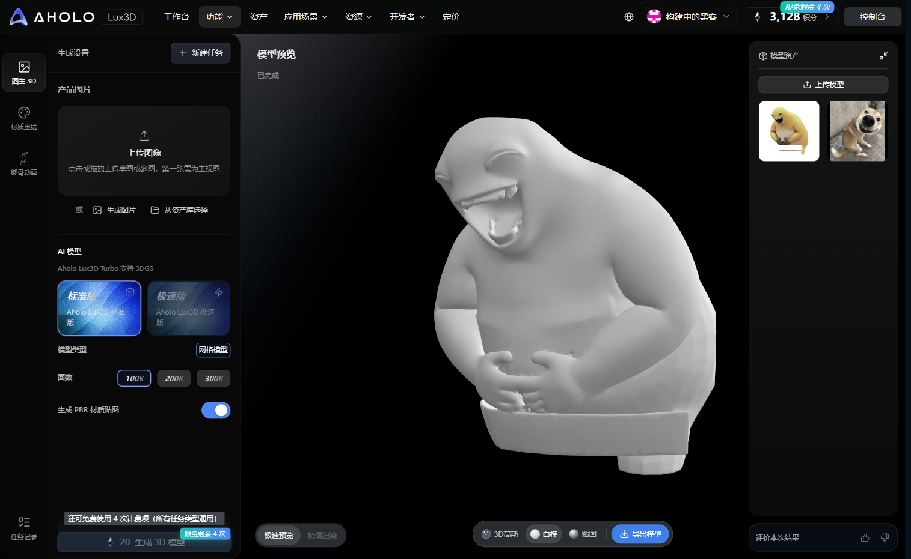

**图 1** · Aholo Lux3D 工作台：标准版 / 网格 / 100K 面数 / PBR 材质，奶蛙白模首次生成。

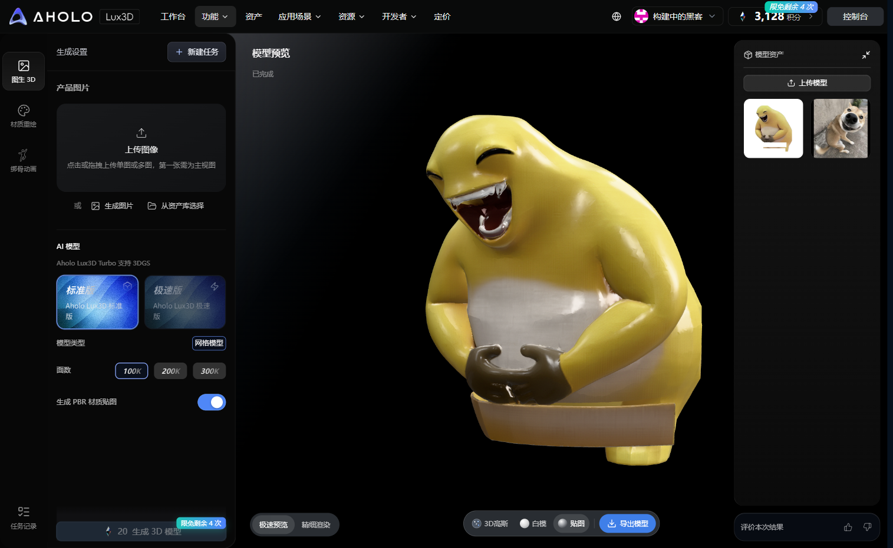

**图 2** · 同批次带 PBR 贴图的模型预览。逐只生成参数、输入图与产物 sha256 见 `evidence/lux3d/资产证据链_第1组.md`～`第8组.md` 及 `manifest.json`。

### 10.2 关键资产迭代对比

| 阶段 | 产物 | 证据 |
|---|---|---|
| ① 干净单主体输入图 | 白底、无文字、单角色 | `evidence/lux3d/manifest.json`（逐只 sha256） |
| ② Lux3D 白模 | 100K 面数网格 | 图 1 |
| ③ PBR 贴图母版 | 约 9 万三角面 | 图 2 |
| ④ 运行时压缩 | 18,990–19,000 三角面 / ≤385KB | `evidence/lux3d/资产证据链_第*.md`、`evidence/v3-20k-metrics-20261109.json`、`docs/evidence/lux3d/manifest.json`（`runtime_glb_shipped.tris`） |
| ⑤ 游戏内 NPR 上屏 | 赛璐璐 + 描边 + 果冻高光 | 图 3～图 7 |

### 10.3 关键效果截图（真实运行画面）

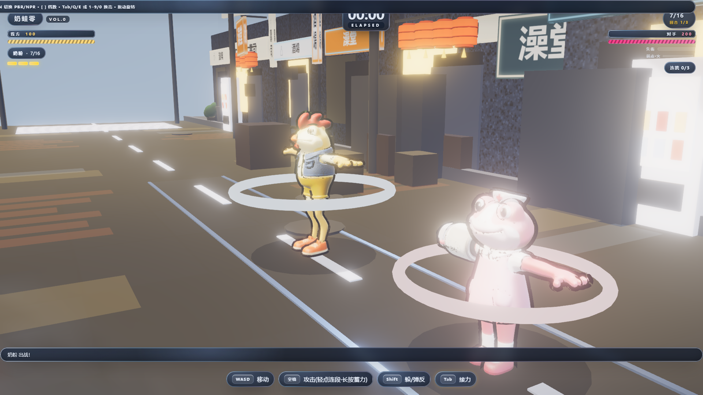

**图 3** · 家族成员「奶粉」：罐体剪影与配件，和基准梨形奶蛙一眼可分。

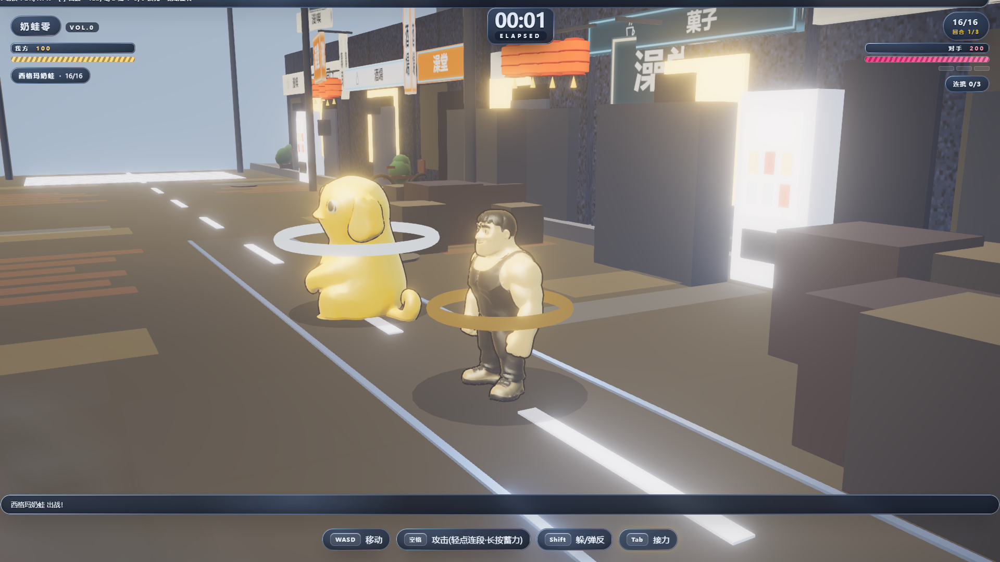

**图 4** · 家族成员「西格玛奶蛙」：拟人化肌肉造型，同源圆润语汇下的另一支剪影。

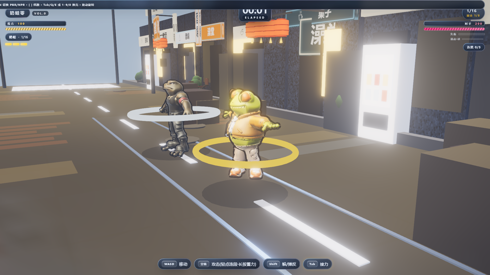

**图 5** · 开局实拍（2026-11-12 定版构建 `index-C6e6LaWv.js` 默认机位）：高饱和霓虹招牌 + 街道纵深，基准梨形奶蛙完整入画；HUD 显示「奶蛙 · 1/16」、`ELAPSED` 正计时、**回合 1/3** 与对手血条。本图为**程序化箱庭场景**（§4.2），画面外圈未见可辨识的 Aholo 街区层——该层仅在屏幕最外圈透出、峰值不透明度 0.32（§10.6），不作为本图的举证点。

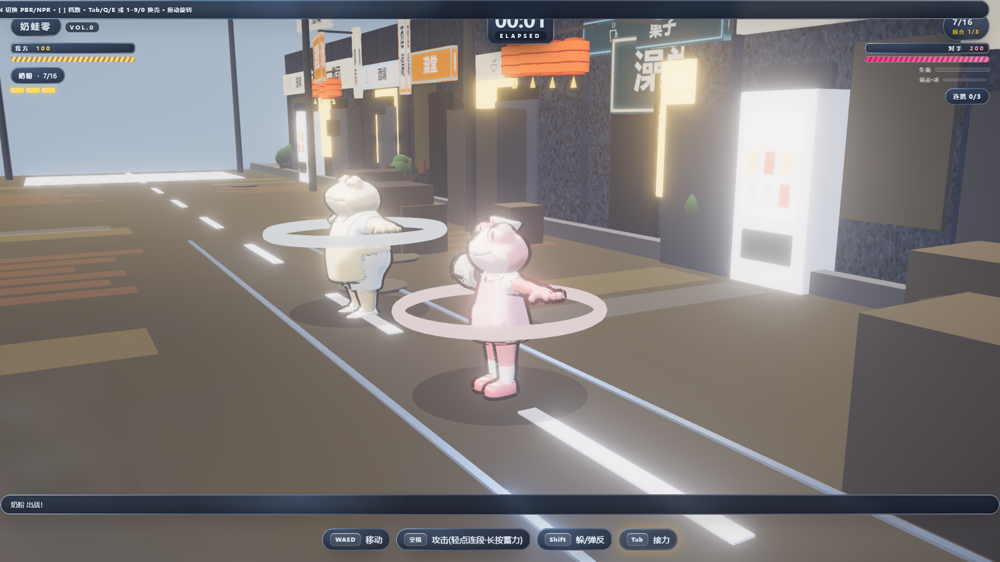

**图 6** · **自研 NPR 管线**：同一机位、同一角色，分别以 NPR 与 PBR 渲染（`v3-npr-on` / `v3-npr-off`）。自写赛璐璐着色器把奶油黄基色压成大色块并压低高光溢出，而 PBR 下同一材质会被亮光烧成一片白——这正是本项目必须自研 NPR 管线而非直接用 PBR 的原因。**像素差分（同机位 A/B，阈值 8/255）**：9.31% 像素发生变化、峰值差 196，取证 `docs/evidence/v3-ab-diff-20261111.json`。

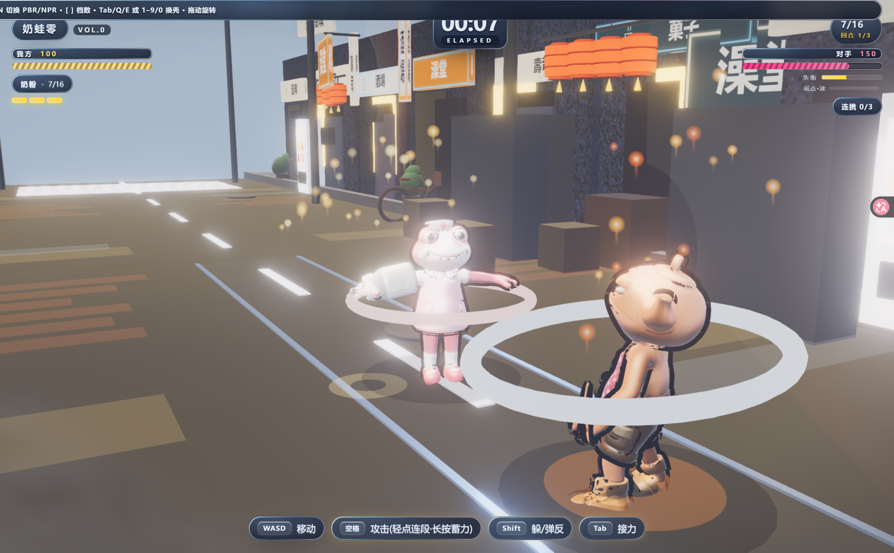

**图 7** · 战斗中的连段瞬间（E2E 实拍）：金属奶粉罐角色出招，HUD 显示「奶粉 · 7/16」、`ELAPSED` 00:10、**回合 1/3**（三连战）与「连携 1/3」；脚下白色环为角色选中环，非打击特效。

### 10.4 界面与流程证据（E2E 实拍）

> 以下取自 `docs/test-report.json`（**33 项全通过**，2026-11-12 深度改造后）的真实浏览器截图，覆盖主界面 → 选人 → 切换成员 → 战斗连段 → 连携 QTE → 喧响终结技 → 结算的完整路径。

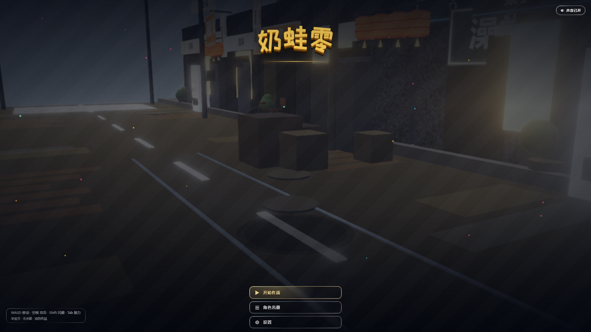

**图 8** · 主界面（2026-11-11 改版后）：自制艺术字标题 + 视频背景 + 液态玻璃质感的三按钮（开始作战 / 角色名册 / 设置），无外部 UI 素材；左下角为操作提示卡与「非官方·无关联·戏仿作品」声明。背景视频为第三方短视频素材，其来源与授权登记见 §5.3 与 `docs/ASSET-LICENSES.md`。

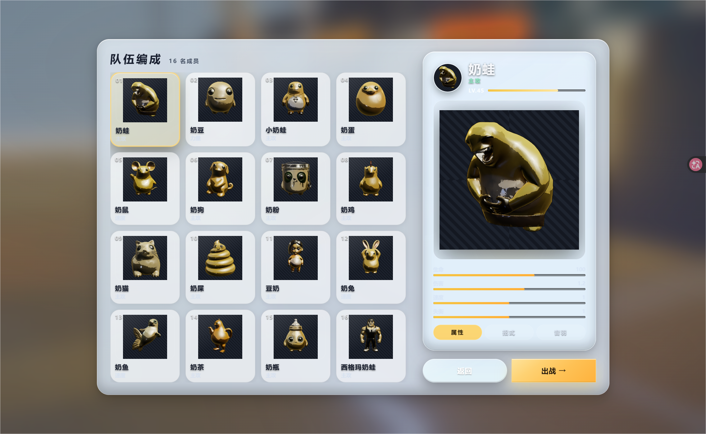

**图 9** · 选人界面：族谱 **16 名成员**逐格列出（奶蛙、奶豆、小奶蛙、奶蛋、奶鼠、奶狗、奶粉、奶鸡、奶猫、奶屎、豆奶、奶兔、奶鱼、奶茶、奶瓶、西格玛奶蛙），右侧为当前成员属性面板。

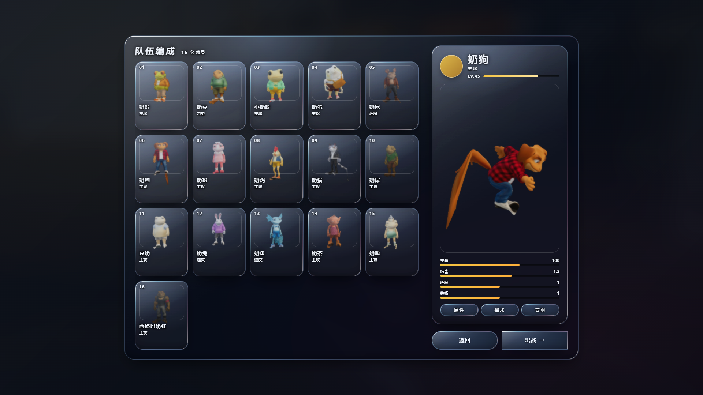

**图 10** · 切换到「奶狗」后的选中态与名称变化；属性面板显示基础值，招式差异化以游戏内接力表现为准，不以此截图单独举证。

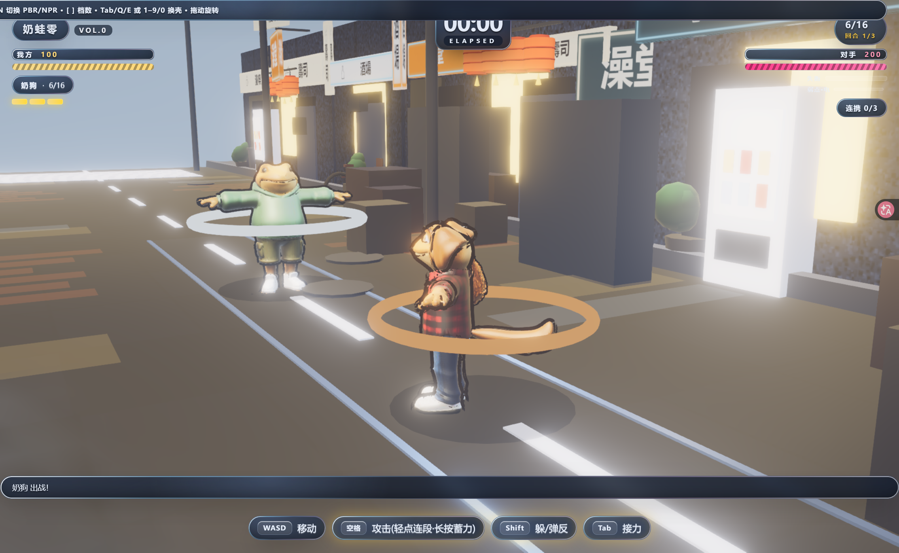

**图 11** · 战斗界面（E2E 实拍）：玩家「奶狗」与对手在霓虹箱庭街道对峙，HUD 显示双方血条、`ELAPSED` 正计时、**回合 1/3**（三连战进度）、**失衡黄条 / 支援点 3 格 / 喧响槽 / 属性异常积蓄条与弱点标记**（2026-11-12 深度改造后）；画面为**程序化箱庭场景**（§4.2），Aholo World 街区层未出现在本机位取景范围内（见 §10.6）。

### 10.5 如实边界

- 未采用含迷因原图（带中文文字的表情包截图）的 `iterations/*_before_after.png` 作为对外素材——按 §5.2 声明，迷因原图不进对外发布材料与源码包。
- `v3-16-family-sheet` / `v3-20k-*-diagnostic` 属调参诊断图：多只角色被光束压成同一黄色半球、剪影不可辨，**不作为家族辨识度举证**；家族剪影以图 3、图 4 及游戏内接力出场为准。
- 选人界面（图 9、图 10）的 16 格为**实时 3D 渲染**（`src/ui/live3d.mjs` 按卡片 DOM 位置摆放 16 只 runtime GLB 并逐帧转身/浮动），每格剪影可辨；该页不再使用静态立绘 PNG。
- 未采用 `test-shots/*-FAIL.png` 历史失败截图，也未采用显示「作战失败 / 0 伤害」的结算测试帧作为效果展示。
- **Demo 视频的如实边界**：现行提交视频为 `demo-video-20261111.mp4`（**84.0 秒 / 1920×1080 / 30fps / 2520 帧**，2026-11-12 **第四次重录**，取自定版构建 `index-C6e6LaWv.js`——与线上魔搭 master `d44ca9f`、gh-pages `f90cc29` 同版），采用 CDP 全页合成录制——DOM HUD（计时 / 回合数 / 失衡黄条 / 喧响槽 / 异常条 / 按键条）、液态玻璃层、实时 3D 选人、3D 光标与视频背景全部入画；操作为脚本驱动（页面键盘事件 + `window.__npr` 诊断 API + DOM click），**非玩家逐键操作，不作为「真人亲手玩」举证**。片中完整演示：三段连段 → 接力换人 → 弹反成功 ×1 → **蓄力终结** → **三连战 0→1→2 回合推进**（每回合之间开 **鸣徽三选一**，由数字键选卡）→ 第 3 回合首领**狂暴** → **属性异常·灼烧** → **紊乱引爆 + 碎冰冻结** → **失衡黄条打满** → **连携技 QTE 3 环连打**（子弹时间 + 换人 3 次）→ **喧响值拉满 → 喧响终结技**（喧响清零 + 2.2s 无敌）→ A 级结算（含逐回合战果条）。**录像专用的状态注入**（与「录像是脚本驱动」同性质，如实登记）：`opponent.hp = 0` 推进回合、`teleportPlayer` 走位、`addAnomaly` / `addDaze` / `setDecibel` / `battle.chainCounts` 把系统推到可演示量级、`debugOpenChain` 开启连携窗口、**第 3 回合首领血量上限放大到 600**（否则新系统合计伤害会中途暴毙首领、后续输入被战斗结束态拦下）。旧 `demo-video-32s.mp4`（52.4s，改版前）与 `demo-video-hd.mp4`（8.1s）留作迭代对比。完整界面另见 §10.4 的 E2E 实拍。**⚠ 时效标注（2026-11-12）**：深度改造（§3.4）已入库并定版构建 `index-C6e6LaWv.js`，本视频早于该构建，按 `AGENTS.md` §4 属**过期证据**，待统一重录；新系统的实拍见 `docs/test-shots/16-chain-qte.png` / `17-ultimate.png`（E2E 实拍）
- 弹反与可破坏箱**已实现**（`src/game/counter.mjs`、`src/world/interactive.mjs`，举证见 §3.3、§4.2）；掩体阻挡与箱体判定偏移两项原缺口已于 2026-11-10 修复（§九 第 5、6 条已更新为修复后口径，2026-11-11 审计复核）。
- `aholo-shell-isolated.png` 是隐藏全部前景后的诊断截图，仅用于确认背景层几何可见，**不作为对外效果展示**；对外效果以 §10.6 待补的重拍图为准。

### 10.6 Aholo World 街区接入（群核技术栈 · 场景侧）

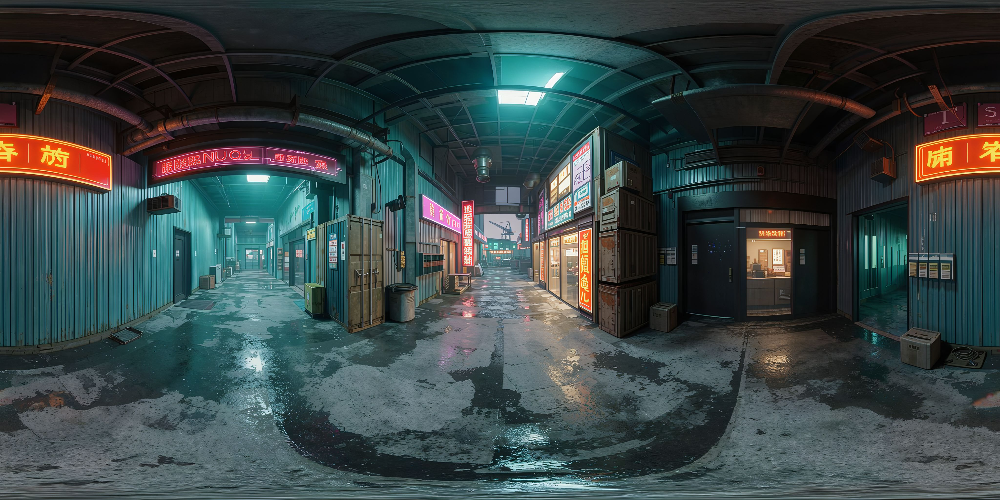

**图 12** · Aholo World 官方世界导出 `aholo.world.export/v1` 中的「霓虹废弃工业巷」4096×2048 全景图。worldId `3FO4K4VSNJ4F` / assetId `3FO4K4WNAN1L` / versionId `16456`；导出元数据与 schema 见 `docs/evidence/lux3d/`。

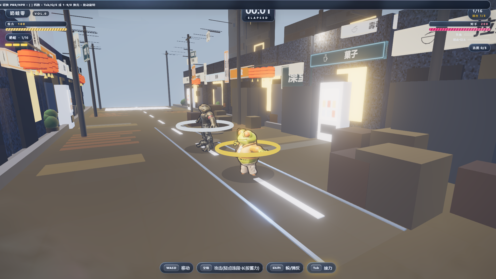

**图 13** · **Aholo World 街区视差层**：同一机位下「开启 / 关闭」该层的对照（`v3-aholo-street-on` / `v3-aholo-street-off`）。**如实边界**：该层按设计只在画面**最外圈**透出（屏幕空间径向遮罩 `smoothstep(0.42, 0.75, d)`、峰值不透明度 0.32），因此在实战取景下它是**克制的氛围叠加**而非可辨识的独立画面——2026-11-09 的美术复核结论亦为「关掉后画面更干净」。**像素差分证明该层确实参与合成**：开 / 关之间 7.16% 像素发生变化、峰值差 99，差异分布在画面四周（取证 `docs/evidence/v3-ab-diff-20261111.json`）。

| 环节 | 数据 |
|---|---|
| 源几何 | 连续表面网格 259,560 顶点 / 473,519 三角面，顶点色由全景图采样 |
| 处理 | `scripts/build-aholo-street.py`：721×360 规则网格降采样、按 3D 边长裁掉深度断裂面与离群点、顶点色压暗降饱和并按 glTF 规范转线性 |
| 产物 | `public/world/aholo-street.glb`：15,782 顶点 / **29,152 三角面** / 589KB；结构自检 **0 error**（`scripts/verify-glb.mjs`：容器头 / chunk 布局 / buffer 与 bufferView 边界 / accessor 越界 / 索引最大值全部通过，18 个交付 GLB 全绿，取证 `docs/evidence/v3-glb-selfcheck-20261111.json`） |
| 上屏 | `src/world/aholo-street.mjs`：屏幕空间径向遮罩 `smoothstep(0.42, 0.75, d)`、峰值不透明度 0.32，只在最外圈透出；`forceSinglePass` 单遍渲染；lite（移动端）档跳过。**遮罩范围经 A/B 实测收窄**：原 0.18/0.56/0.60 会在画面中部糊出一条白雾带、边缘灰白块，把招牌文字冲淡；A/B 对照显示关闭该层后画面更干净，故只保留最外圈一点写实质感 |
| 性能实测 | 同一帧开关背景层对比（2026-11-12 实测，取证 `docs/evidence/v3-runtime-metrics-20261111.json`）：开 **351 draw call / 126,686 三角面** vs 关 **346 / 97,486** —— 三角面差值恒为 **+29,200**（= 背景层自身面数），draw call 差值 **+5**（背景层为多层视差实体，多层各占一次 draw call） |

**如实边界**：这是视差氛围层，不是完整场景替换；玩法空间、店铺立面、地面与碰撞仍为程序化几何（§九第 2 条）。导出 schema 标 Z-up、而 surface PLY 自注 `RH_Y_UP_M`，本项目按 PLY 注释以 Y-up 直接接入 Three.js，未做轴向旋转。美术升级（§10.7）后已重录 `demo-video-32s.mp4`（52.4 秒）并重拍当时的游戏内插图；**2026-11-11 首页整体改版后再次重录 `demo-video-20261111.mp4`（53.7 秒，全页含 HUD）并重拍图 3–图 5（v3-show4），图 7–图 11 随 E2E 25/25 复跑刷新**；图 1、图 2 为 Lux3D 工作台截图，不受该层影响。**该层的游戏内实拍图（现为待补图 13）尚未取得**——现行取景（§10.3 图 5 / 图 11）均为程序化箱庭场景，画面最外圈未透出本层。

### 10.7 美术升级（2026-11-10）

初版画面存在三类「半成品感」，本轮针对性重做：

| 问题 | 原状 | 现在 |
|---|---|---|
| 家族只做了 3 只 | 选人界面 16 格里 **13 格是纯色块占位** | 16 只全部接入，选人页改为**实时 3D 渲染**（`src/ui/live3d.mjs`：16 只 runtime GLB 按卡片 DOM 位置摆放、逐帧转身与浮动，单 scene / 单 camera / 单 render），16 格剪影逐格可辨；该页不再使用静态立绘 PNG |
| 招牌全是无字色块 | 招牌文字用几何色块「示意」，刻意避字体依赖 | 真中文霓虹管（白字芯 + 彩色外晕 + 霓虹边框），店面横向招牌与街面悬挂招牌全部换掉；文案为通用生活词（麻辣烫 / 便利店 / 拉面 / 烧烤 …），不含任何品牌名 |
| UI 是圆角软面板 | 系统默认字重、圆角、纯色进度条 | 圆角液态玻璃材质：16px 圆角控件 + `backdrop-filter` 毛玻璃 + 渐变描边环 + 指针跟随镜面高光 + 多层 inset 厚度；战斗 HUD 胶囊与计时器统一为浅玻璃深字；并补上 `backdrop-filter` 前缀修复插件（否则 Chrome 154 上静默失效） |
| 主角像发光灯泡 | bloom 阈值 0.72，把亮黄奶蛙整只判成高光泛光 | 阈值提到 **0.90**（`src/main.mjs:88`），只让霓虹招牌泛光；角色五官与材质恢复清晰 |

升级后重录 52.4 秒视频、重拍 §十 9 张游戏内插图（对应 2026-11-10 当时的构建）。

> **2026-11-11 收口审查更正**：此后首页又经历视频背景、艺术字标题、WebGL 液态玻璃、深色模式、响应式、实时 3D 选人页与 3D 光标等整体改版，上述视频与插图曾不对应当前构建（按 `AGENTS.md` §4 属过期证据）——**已于 2026-11-11 完成：视频重录为 `demo-video-20261111.mp4`（53.7 秒，全页含 HUD），§十图 3–图 5 重拍为 v3-show4 系列，图 7–图 11（E2E 实拍）随 25/25 复跑刷新**；当前线上版本口径以 `docs/submission.json` 的 `demo_url_note` 为准。
>
> **2026-11-12 统一收口更正**：此后又经历「慢网络加载治理」与「绝区零对标深度改造阶段 A–G」，视频与插图再次落后于构建。**已按 §4 统一重跑**：定版构建 `index-C6e6LaWv.js`（魔搭 master `d44ca9f` / gh-pages `f90cc29`，34 个交付文件逐字节一致）→ Demo 视频**第四次重录**（84.0 秒 / 2520 帧，含阶段 A–G 全部新系统）→ §十 13 张插图与界面流程 13 张实拍按新构建重拍 → 性能取证（`v3-runtime-metrics` / `v3-stability`）重测 → 报告书与 `submission.json` 全部口径同步为实测值。**当前仓库 `src/`、线上构建、视频、插图、报告书五者同版**（以 `docs/submission.json` 的 `demo_url_note` 与 `frozen_commit` 为准）。

---

## 十一、「换壳即换招」专项（比赛技术栈分核心证据）

### 设计口径

比赛要求（计划书 §178）：Lux3D 生成的外壳必须决定**连携招式、判定框、冲击帧内容**——是玩法变量，不是皮肤。

### 16 只角色的招式差异

| 维度 | 差异范围 | 证据 |
|---|---|---|
| **动作风格** | 6 种（挥击/突刺/旋转/砸地/啄击/鞭击） | `src/game/moves.mjs` |
| **招式克制** | 6 环单环（spin→thrust→slam→slash→peck→lash→spin）：克制 ×1.25 / 平手 ×1.0 / 被克 ×0.85；**无自克、无互克**（保证反对称） | 同上（`STYLE_COUNTER` / `styleRelation`） |
| **判定范围** | 2.2–3.4（极差 1.2） | 同上 |
| **判定宽度** | 0.5–3.0（极差 2.5） | 同上 |
| **冲击帧形状** | 7 种（ring/line/multi/cloud/point/claw/arc） | 同上 |
| **冲击强度** | 0.6–1.8（极差 1.2） | 同上 |
| **连携慢镜** | 0.25–0.6s（极差 0.35） | 同上 |
| **连携推近** | 0.9–1.3（极差 0.40） | 同上 |
| **连段节奏** | 三段全量 0.18–0.48s（极差 0.30）；自动化用例断言的是首段 0.18–0.36s（极差 0.18） | 同上 |

### 自动化验证

`npm run test:moves` → **14/14 通过**（`docs/moves-test-report.json`）

- 16 只招式定义完整
- 风格/判定/冲击/连携/节奏五个维度均有差异
- `MOVES`（招式表）与 `SQUAD`（花名册）id 集合**双向**对齐，无缺无多（用例名沿用「与主仓 SHELLS 16 条对齐」的历史表述，实际比对源是 `src/game/squad.mjs`）
- **招式克制表**（2026-11-11 新增 4 项）：覆盖全部 6 种动作风格 · 构成单环（无自克、无互克、被克覆盖 6/6）· 三档倍率取值正确（1.25 / 1 / 0.85）· `styleRelation` 与克制表在 **36 组风格组合**上全部一致且反对称

`npm test`（E2E）→ **33/33 通过**（2026-11-12）。2026-11-11 新增 3 项：**三连战回合推进**（击败对手 → 进入下一回合而非直接结算，打完 3 个才结算且结算页列出 3 条战果）、**招式克制关系生效**（克制表反对称性与伤害倍率）、**蓄力必杀技**（长按空格蓄满 → 蓄力条满格 → 松手发出高伤终结）；**2026-11-12 深度改造再增 5 项**：连携技 QTE（注入失衡 → QTE 激活 → 数字键选人 → 断言换人/支援点+1/环数耗尽自动关闭）、喧响值与终结技（满 [极] → 蓄力 → 断言 ULT 档伤害 ×2 / 喧响清零 / 支援点回满 / 无敌帧）、属性异常与紊乱（注满火 → 断言灼烧 DoT 掉血 → 再注满冰 → 断言紊乱引爆+冻结）、首领狂暴触发（回合 3 血量 <50% → 断言狂暴标志）、鸣徽三选一（注入开启 → 选卡 → 断言 buff 入账并回战斗）。

**用例自身的严谨性修复**（2026-11-12 统一收口时发现并修掉，如实登记）：「WASD 移动生效」用例原实现有**两处问题**——①把玩家播种到 `x = 6`，而场地边界 `movement.mjs bounds.x = 4.5`，**首帧夹紧会凭空产生 1.5 的假位移**，旧断言（位移 > 0.3）在「完全没移动」时也可能通过，判据形同虚设；②按「按住 500 ms 一次性采样」判定位移，而在测试宿主把 rAF 节流时（实测 1.5 s 内只推进 1 帧、位移 0.12）会把**宿主帧饥饿误判成「移动失效」**，该用例因此长期 flaky。修复后改为**边界内播种（x = 4.4）+ 按住不放并轮询位移**，判据本身（「位移 > 0.3」且「按 A 的位移必须含屏幕左分量」）**不变、不放宽**；同时为该用例补了**状态快照**（战斗相位 / 是否在战斗中 / 鸣徽暂停 / 连携 QTE / 顿帧 / 按键集合 / 移动速度 / 速度向量 / 位置 / 独立 rAF 帧计数 / 累计时长差值），今后同类红灯可直接定位而不必再靠猜。修复后连续 3 轮 E2E **33/33**。

### 结论

**Lux3D 产物真正驱动玩法**——每只角色的 GLB 外壳对应独立的招式参数（动作风格 / 判定框 / 冲击帧 / 演出节奏），且 16 只模型的**几何体、贴图与剪影本身互不相同**（逐只独立造型，非换色，见 §10.3 图 3、图 4）。如实边界：`src/game/moves.mjs` 的 `getMove()` 对未知 id 会**回退到基准角色「奶蛙」**，因此移除某只角色后其专属招式参数不再被引用（表现为回退到「笑波」），而非彻底缺失。这满足「参与核心 3D 内容与关键创作流程」的参赛要求。

---

## 十二、自动化测试体系

### 测试工作流

```bash
npm test          # 一键：构建 → 启动 → 33 项测试 → 报告
npm run test:moves # 「换壳即换招」专项（14 项）
```

### 覆盖维度（33 项）

| 维度 | 用例数 | 内容 |
|---|---|---|
| 界面 | 6 | 主界面 / 选人 / 切换角色更新展示台 / 战斗 / 结算 / 返回 |
| 角色 | 3 | 16 只加载/切换/属性 |
| 动画 | 4 | idle/移动/攻击/受击 |
| 画面 | 5 | NPR 材质/贴图/Bloom/渲染统计/相机 |
| 交互 | 15 | 移动/攻击/连段/闪避/换人/模式切换/无报错 + 三连战回合推进 / 招式克制关系 / 蓄力必杀技（11-11）+ **连携技 QTE / 喧响值与终结技 / 属性异常与紊乱 / 首领狂暴触发 / 鸣徽三选一**（11-12 深度改造新增） |

### 报告产出

- `docs/test-report.json` — 完整断言结果（最近一轮 2026-11-12，33/33 通过）
- `docs/test-shots/` — **17 张界面流程实拍**（`01-title` ～ `17-ultimate`，2026-11-12 深度改造后当前构建实拍；含 14 三连战 / 15 蓄力终结 / **16 连携 QTE / 17 喧响终结技**）

### 测试暴露的真实 bug（已修复）

| Bug | 影响 |
|---|---|
| 闪避不位移（movement 没收到 dodge 参数） | 闪避完全失效 |
| 移动方向错误（相机转换逻辑错） | 按 A/D 跑偏 |
| 对手 AI 乱跑 Z 方向 | 追不到对手 |
| 缩略图 GLB 路径双重拼接 | 16 张头像全部失败 |
| 对手进战斗后被隐藏 | 战斗无对手 |

---

## 十三、附录

### 交付物

| 材料 | 位置/链接 | 状态 |
|---|---|---|
| 在线 Demo（提交用） | https://www.modelscope.cn/studios/zgqy379/naiwa-zero-demo | 魔搭 **Static** 创空间（读远端 `master` 分支）。2026-11-12 部署 `index-C6e6LaWv.js` 定版（魔搭 master **`d44ca9f`**，含阶段 A–G 八个新系统的全量）：入口与 **34 个交付文件**实测全部可取（GET/Range 200 或 206；**HEAD 一律 403，不可用作判据**；`index.html` 为 301→根路径 200，含 `bg/title.mp4` 8.33 MiB 与 `fonts/LICENSES.txt` 字体许可全文），创空间 iframe 实机截图 `docs/evidence/v3-deploy-live-studio-20261112.png`（2026-11-12 复拍），验收明细见 `docs/evidence/deploy-acceptance-20261111.json`。**魔搭通道的访问特性**：应用只以 **iframe** 形式跑在创空间页里（平台把 `ms.show` 根路径重定向到自己的壳页），故直接访问 `ms.show` 看到的是平台页而非游戏——**评审请从上面的创空间地址进入**。首页已不再是静态 3D 立绘 |
| 备用直达链接 | https://zgqy379.github.io/naiwa-zzz-demo/ | 直连 Demo（无 iframe 壳）。2026-11-12 复测：**34 个交付文件 GET/Range 全部 200/206**，且入口 `index.html` 与主 JS `index-C6e6LaWv.js` 与本仓 `dist/` **逐字节一致**（sha256 前 16 位 `A2EDFF3B33F66DC7` / `EB060AB7F155E887`）——与魔搭部署**同版**。原 workbuddy 地址已失效（只返回引用旧构建 `index-iKSx0O26.js` 的壳页，静态资源全部 403），不再列为备用。**真实浏览器实机验收**（2026-11-12，ego lite 真实浏览器打开线上地址）：入口脚本确认为 `index-C6e6LaWv.js`；阶段 A–G 的五个 HUD 节点（失衡条 / 喧响槽 / 支援点 / 异常条 / 蓄力条）**全部在位且可见**；选人 → 出战 → 进入战斗流程跑通（`phase=playing`、`回合 0/3`、支援点 3、对手弱点随机为「电」）；取证 `docs/evidence/v3-online-verify-20261112.json`，实拍 `docs/evidence/v3-online-{title,battle}-20261112.png` |
| 源码仓库 | https://github.com/zgqy379/naiwa-zzz-demo | 加分项。**已随官网第 5 版提交登记**（源码在 `main` 分支；仓库默认分支 `gh-pages` 是构建产物，故提交链接指到 `/tree/main`）。仓库 public，`main` 分支含完整 `src/`、`docs/`、`scripts/`、`tests/` 与本报告书 |
| 官网提交记录 | 群核科技 Aholo 全球 3D AI 黑客松 →「我的参赛 → 我的作品」 | **第 5 版 · 提交于 2026-11-12 13:31**，平台状态「已提交 · 作品已进入资格与完整性审核」（评审以 11-19 19:00 前最后一次成功提交的版本为准）。提交内容：Demo = 上面第一行的魔搭创空间；项目报告书 = 上传文件（平台落盘 `https://holo-cos.aholo3d.cn/public/NL2UQ3AKTK2RYAABAAAAADY8.pdf`，16,173,847 B，与本仓 `docs/report.pdf` **逐字节一致**）；生态合作设备/技术使用情况 = 无；应用赛道 = 游戏应用奖、空间设计应用奖；源码 = 上面那行。**如实留白**：加分项「社交媒体发布链接」本轮空缺（未在小红书发布），详见 §十 末尾与 `docs/submission.json` 的 `rednote_url` 口径 |
| Demo 视频（提交用） | `docs/demo-video-20261111.mp4`（**84.0 秒 / 30fps / 1920×1080 / 2520 帧**，32,665,099 B） | **现行版**：2026-11-12 **第四次重录**，取自定版构建 `index-C6e6LaWv.js`（与线上魔搭 master `d44ca9f` / gh-pages `f90cc29` 同版）全页合成，含 DOM HUD / 液态玻璃 / 实时 3D 选人 / 3D 光标 / 视频背景；片中演示三段连段 / 接力换人 / 弹反成功 ×1 / **蓄力终结** / **三连战 0→1→2 回合推进（回合间鸣徽三选一）** / **首领狂暴** / **属性异常·灼烧 + 紊乱引爆** / **失衡打满** / **连携技 QTE 3 环连打** / **喧响满极终结技** / A 级结算（含逐回合战果条）；零 console 错误、黑帧检测 0 段，取证 `docs/evidence/v3-demo-rec-20261111.json`（录像为脚本驱动 + 状态注入，如实边界见 §10.5）。旧 `demo-video-32s.mp4`（52.4s，改版前）与 `demo-video-hd.mp4`（8.1s）留作迭代对比 |
| 过程截图 / 迭代对比 / 效果截图 | 见 §十（**13 张插图**：生成过程 2 / 效果 5 / 界面流程 4 / 街区 2）与 `docs/evidence/` | 已备齐 |
| 项目报告书 | 本文件 | 已备齐 |

### 资产清单

- **角色 GLB**：族谱 **16 只**，逐只独立造型（非换色），Lux3D 图生 3D；runtime 每只 **18,990–19,000 三角面 / ≤385KB**（实测值，逐只见 `docs/evidence/lux3d/manifest.json` 的 `runtime_glb_shipped.tris`）
- **逐只哈希与生成参数**：`docs/evidence/lux3d/manifest.json` + `资产证据链_第1组.md`～`第8组.md`
- **场景**：玩法空间 / 店铺立面 / 地面 / 碰撞为 100% 程序化几何；另有 Aholo World 导出街区表面网格（减面至 29,152 面，见 §10.6）作为画面边缘的视差氛围层
- **音频**：Web Audio 程序化合成（BGM / 打击音 / UI 音 / 环境音），零外部音频文件

### 技术栈版本

- Three.js 0.187 / Vite 8.3.6 / Aholo World 世界导出（`aholo.world.export/v1`）；资产运行时压缩见 §10.2（weld→simplify→resize→webp→quantize→meshopt）
